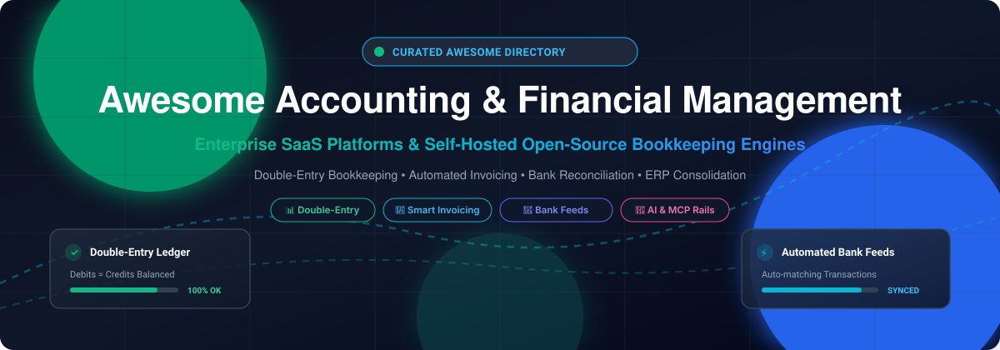

# 💼 Awesome Accounting & Financial Management

  

  
  
  
  
  
  

---

> **A curated, battle-tested directory of top SaaS platforms and open-source financial management engines.**
> *Covering double-entry bookkeeping, automated invoicing, multi-currency ledger engines, bank reconciliation feeds, corporate performance management (CPM), and self-hosted ERP alternatives.* 🌟 **Star the repository if you find it useful!** 🌟

---

## 📌 Table of Contents

- [🌐 Sector Overview & Market Dynamics](#-sector-overview--market-dynamics)
- [☁️ SaaS / Hosted Platforms](#️-saas--hosted-platforms)
- [💻 Open-Source GitHub Projects](#-open-source-github-projects)
- [🛠️ Architectural Guidance & Stack Comparison](#️-architectural-guidance--stack-comparison)
- [📈 Star History](#-star-history)
- [🤝 How to Contribute](#-how-to-contribute)
- [☕ Support & Sponsorship](#-support--sponsorship)
- [⚖️ Disclaimer](#️-disclaimer)

---

## 🌐 Sector Overview & Market Dynamics

The global accounting software market is valued at approximately **$20.8B–$23.1B in 2025** and projected to surpass **$24.9B+ by 2026** (expanding at a compound annual growth rate of ~8–9%). 

The ecosystem exhibits **moderate concentration with a distinct bimodal structure**:
1. **Concentrated Enterprise & CPM Tier:** High-end ERP consolidation and Corporate Performance Management are held by a tight cluster of established leaders (Oracle NetSuite, Intuit, The Sage Group, SAP, and OneStream).
2. **Fragmented SME & Regional Tier:** The small-to-medium enterprise, freelancer, and micro-business segment is characterized by heavy fragmentation. Regional regulations, tax compliance frameworks (e.g., Making Tax Digital, GST, e-invoicing mandates), and local banking rails demand localized platforms and encourage self-hosted open-source software adoption.

---

## ☁️ SaaS / Hosted Platforms

*Below is a comprehensive comparison of leading commercial accounting and ERP solutions, sorted in descending order by company valuation / market size.*

| Product | 🏢 Company Size / Valuation / Revenue | 💳 Pricing (Specific Starting Tiers) | 🎁 Free Tier / Trial Limits | 🎯 Description & Best For | ⚠️ Trade-offs |
| :--- | :--- | :--- | :--- | :--- | :--- |
| **[NetSuite](https://www.netsuite.com)** | ~$350B–$374B market cap *(Parent: Oracle)* | Starts at **$999/month base fee** + **$129–$199/user/month** (annual agreement required, ~$25,000–$50,000+/year min.) | **14-day free trial** via partner/discovery consultation (pre-configured sandbox environment with sample corporate data; no instant public self-serve free plan) | Enterprise ERP with unified double-entry ledger, multi-subsidiary consolidation (OneWorld), automated tax compliance, and supply-chain/inventory. Best for mid-market to enterprise companies scaling globally. | High implementation overhead ($25K–$100K+) and lengthy deployment cycles. |
| **[QuickBooks Online](https://quickbooks.intuit.com)** | ~$90B–$95B market cap; ~$16B+ ARR *(Intuit)* | Simple Start: **$35/month**; Essentials: **$65/month**; Plus: **$99/month**; Advanced: **$235/month** | **30-day free trial** with full feature access for the selected tier (credit card required at setup; automatic transition to paid tier unless canceled; no permanent free plan) | De facto SMB accounting standard with the largest accountant network, payroll add-ons, and third-party app ecosystem. Best for small businesses needing universal CPA collaboration. | Add-on costs escalate quickly; desktop versions phased out in favor of monthly cloud licenses. |
| **[FreeAgent](https://www.freeagent.com)** | ~$63B–$67B market cap *(Parent: NatWest Group; acquired for £53M / ~$75M)* | Sole Trader: **£19/month** (~$24/mo); Partnership: **£24/month** (~$31/mo); Limited Co: **£33/month** (~$42/mo) | **30-day free trial** (max 2 recipient email addresses during trial; no credit card required); **100% Free forever** for NatWest, Royal Bank of Scotland, Ulster Bank, and Mettle business bank account holders | Cloud bookkeeping and tax platform built specifically for UK sole proprietors, freelancers, and small businesses with automated HMRC self-assessment filing. | Heavily focused on UK accounting rules; limited native multi-currency and international reporting support. |
| **[Sage Intacct](https://www.sage.com/en-us/products/sage-intacct/)** | ~$11.7B / £10.6B market cap *(Parent: The Sage Group plc)* | Starts at **$900–$1,000/month** (~$11,000–$12,000/year base for 1 entity / 1 full user; avg. contract $20,000–$35,000+/year) | **30-day free trial** (sandbox environment with pre-populated sample industry data; accessed via demo request, no permanent free tier) | Cloud financial management and multi-entity dimensional reporting built for finance leaders. Best for mid-market growing companies requiring strict GAAP/IFRS controls and AICPA endorsement. | Substantial upfront setup and partner implementation fees ($12,000+). |
| **[Zoho Books](https://www.zoho.com/books/)** | ~$12.4B–$15B estimated private valuation; ~$1.5B annual revenue *(Zoho Corp)* | Standard: **$15/month** ($20 billed mo.); Professional: **$40/month**; Premium: **$60/month**; Elite: **$120/month** | **Free forever plan** (strictly limited to businesses with **< $50,000/year revenue**, **1 user + 1 accountant**, up to **1,000 invoices/year**, **1,000 bills/year**, and **50 autoscans/month**; 14-day trial for paid tiers) | End-to-end cloud accounting deeply integrated into the Zoho business ecosystem. Best for SMBs seeking full-featured, affordable automation. | Features segregated across tiers; non-Zoho third-party integrations require custom setups. |
| **[Xero](https://www.xero.com)** | ~$10.7B–$11.5B AUD market cap (~$7B USD) | Early: **$20/month** (capped at 20 invoices); Growing: **$47/month**; Established: **$80/month** | **30-day free trial** with access to core features or built-in demo company data (no credit card required; data turns read-only after 30 days) | Cloud accounting known for intuitive UI, automated bank reconciliation, and broad accountant collaboration. Best for SMBs and modern online businesses. | Entry plan has severe invoice volume limits (20 invoices/month); advanced analytics require add-ons. |
| **[Wave](https://www.waveapps.com)** | ~$6.5B market cap *(Parent: H&R Block; acquired for $405M)* | Pro Plan: **$19/month** (or $190/year billed annually) | **Starter Plan is Free forever** (includes unlimited invoicing, expense tracking, and manual bank imports; excludes automatic bank feeds, receipt OCR, and automated payment reminders) | Lightweight accounting and invoicing designed for micro-businesses, freelancers, and solopreneurs looking for zero-cost core bookkeeping. | Lacks inventory management, audit trails, and formal purchase order workflows. |
| **[OneStream](https://www.onestream.com)** | ~$6.4B valuation *(acquired by Hg in 2026; ~$600M ARR)* | Enterprise quote-based; baseline contract starts at **~$10,000–$15,000/month** (~$120,000–$178,000+/year avg. ACV) | **No self-serve free trial**; evaluation conducted through sales-engineered **Proof of Concept (POC) / Proof of Value (POV)** tenants loaded with customized data | Enterprise Corporate Performance Management (CPM) unifying financial consolidation, budgeting, close management, and AI predictive forecasting on Extensible Dimensionality. | Heavyweight deployment requiring enterprise system integrators; not suited for SMBs. |
| **[FreshBooks](https://www.freshbooks.com)** | ~$1.0B valuation *(Series E unicorn; ~$55M+ ARR)* | Lite: **$19/month**; Plus: **$33/month**; Premium: **$60/month** | **30-day free trial** with full feature access across standard plans (no credit card required; requires plan selection afterwards) | User-friendly invoicing and expense tracking designed for service providers, agencies, and consultants. Best for time-tracking and client-billed expense projects. | Limited double-entry bookkeeping depth; costs scale rapidly with billable client counts. |
| **[Kashoo](https://www.kashoo.com)** | ~$1M–$2M ARR *(Privately held; strategic investment from Paychex)* | Single flat tier at **$30/month** (or $240/year billed annually; introductory offers often ~$20/mo) | **14-day free trial** (no credit card required; full access to all features, 90-day grace read-only period post-trial) | Simple cloud accounting focused on automated bookkeeping, smart transaction matching, and single-screen expense sorting. Best for micro-businesses wanting uncomplicated books. | Minimal third-party app ecosystem; basic inventory and reporting capabilities. |

---

## 💻 Open-Source GitHub Projects

*Open-source platforms allow complete self-hosting, full data sovereignty, zero recurring license fees, and freedom to extend features. Repositories below are ordered by GitHub Stars_Count in descending order.*

### 1. 🌟 [frappe/erpnext](https://github.com/frappe/erpnext)

- **Description**: The world's top open-source ERP system featuring an extensive, enterprise-grade double-entry financial accounting engine.
- **Key Features**: General Ledger, Chart of Accounts, Accounts Payable & Receivable (AP/AR), multi-currency, cost center allocation, bank reconciliation, automated billing, taxation compliance, asset management, and financial reporting (Balance Sheet, P&L, Cash Flow).
- **Tech Stack**: Python, Frappe Framework, MariaDB, JavaScript, Redis.
- **License**: GPL-3.0.
- **Best For**: Businesses seeking an end-to-end, full-featured ERP and accounting powerhouse that scales from small teams to enterprise level.

### 2. 🌟 [firefly-iii/firefly-iii](https://github.com/firefly-iii/firefly-iii)

- **Description**: A self-hosted personal finance and double-entry money manager designed to track budgets, expenses, and asset accounts.
- **Key Features**: Double-entry accounting principles, rule-based auto-categorization, bank import via Spectre/Nordigen/Plaid, multi-currency support, liability and credit card tracking, and comprehensive budgeting tools.
- **Tech Stack**: PHP (Laravel), MySQL/PostgreSQL/SQLite, Docker.
- **License**: AGPL-3.0.
- **Best For**: Solopreneurs, freelancers, and individuals wanting strict double-entry tracking of all cash flows and account balances.

### 3. 🌟 [invoiceninja/invoiceninja](https://github.com/invoiceninja/invoiceninja)

- **Description**: Leading self-hosted invoicing, billing, and expense management platform with cross-platform mobile and desktop apps.
- **Key Features**: Client invoicing, recurring billing, auto-billing, quotes and proposals, payment gateway integrations (Stripe, PayPal, Mollie, 30+ gateways), expense tracking, and client portal.
- **Tech Stack**: PHP (Laravel), Flutter (desktop & mobile clients), MySQL.
- **License**: Elastic License 2.0 / AGPL-3.0.
- **Best For**: Freelancers, agencies, and SMBs needing professional invoicing and payment processing workflows without subscription fees.

### 4. 🌟 [akaunting/akaunting](https://github.com/akaunting/akaunting)

- **Description**: Free and open-source online accounting software designed for small businesses and freelancers.
- **Key Features**: Full double-entry bookkeeping, invoicing, bill tracking, vendor management, cash flow reporting, banking feeds, inventory management, and an extensive app marketplace for extensions.
- **Tech Stack**: PHP (Laravel), Vue.js, Tailwind CSS, MySQL.
- **License**: GPL-3.0.
- **Best For**: Small business owners wanting a clean, modular, web-based accounting interface similar to QuickBooks.

### 5. 🌟 [idurar/idurar-erp-crm](https://github.com/idurar/idurar-erp-crm)

- **Description**: Modern open-source ERP and CRM system with integrated accounting and invoice management built on the MERN stack.
- **Key Features**: Invoice generation, quotation management, payment tracking, customer relationship management, expense monitoring, and role-based permissions.
- **Tech Stack**: Node.js, Express, React, Redux, MongoDB.
- **License**: Open Source.
- **Best For**: JavaScript/Node.js developers wanting a customizable, developer-friendly billing and business management platform.

### 6. 🌟 [crater-invoice-inc/crater](https://github.com/crater-invoice-inc/crater)

- **Description**: Open-source invoicing suite designed for freelancers and small business owners with accompanying companion apps.
- **Key Features**: Invoicing, estimates, payment tracking, expense management, customizable tax settings, detailed reports, and mobile application support.
- **Tech Stack**: PHP (Laravel), Vue.js, React Native, MySQL.
- **License**: AGPL-3.0.
- **Best For**: Solo operators seeking a lightweight, self-hosted invoicing solution with dedicated mobile clients.

### 7. 🌟 [Dolibarr/dolibarr](https://github.com/Dolibarr/dolibarr)

- **Description**: Mature open-source all-in-one ERP and CRM suite with extensive financial and double-entry accounting modules.
- **Key Features**: Double-entry general ledger, bank account reconciliation, billing, purchase orders, inventory, tax reports, multi-currency, and Point-of-Sale (POS).
- **Tech Stack**: PHP, MariaDB/MySQL/PostgreSQL.
- **License**: GPL-3.0.
- **Best For**: Small to enterprise-scale businesses and foundations requiring an established, modular open-source ERP.

### 8. 🌟 [beancount/beancount](https://github.com/beancount/beancount)

- **Description**: A computer language that implements double-entry bookkeeping using plain text files and Python-based balance sheet generation.
- **Key Features**: Plain-text accounting, immutable ledger history, SQL-like querying syntax (`BQL`), multi-commodity assets, investments tracking, and integration with the web-based visualization UI [Fava](https://github.com/beancount/fava).
- **Tech Stack**: Python, C (core parsing), Plain Text files.
- **License**: GPL-2.0.
- **Best For**: Developers, technical accountants, and financial engineers who value git-versioned, plain-text bookkeeping.

### 9. 🌟 [ledger/ledger](https://github.com/ledger/ledger)

- **Description**: The classic, high-performance command-line double-entry accounting tool that originated the Plain Text Accounting (PTA) movement.
- **Key Features**: Blazing-fast CLI ledger parsing, double-entry validation, balance and register reporting, currency conversion, and scriptable automation.
- **Tech Stack**: C++, Boost, CMake.
- **License**: BSD-3-Clause.
- **Best For**: CLI power users and engineers wanting minimalist, ultra-fast financial tracking without databases or web servers.

### 10. 🌟 [hql287/Manta](https://github.com/hql287/Manta)

- **Description**: Flexible, elegant desktop invoicing application for freelancers with customizable templates and instant PDF generation.
- **Key Features**: Beautiful printable invoice templates, drag-and-drop line reordering, local data persistence (no cloud dependency), SVG logos, and custom tax rates.
- **Tech Stack**: Electron, React, Redux, Webpack.
- **License**: MIT.
- **Best For**: Freelancers and creative professionals needing an offline desktop tool to generate crisp invoice PDFs without ongoing subscriptions.

### 11. 🌟 [frappe/books](https://github.com/frappe/books)

- **Description**: Free, lightweight, local-first double-entry desktop bookkeeping software built by the creators of ERPNext.
- **Key Features**: Double-entry ledger, invoicing, bills, journal entries, payment records, offline-first SQLite backend, and native financial reports.
- **Tech Stack**: Electron, Vue.js, SQLite.
- **License**: AGPL-3.0.
- **Best For**: Small business owners seeking a desktop alternative to QuickBooks that works offline with zero cloud telemetry.

### 12. 🌟 [Gnucash/gnucash](https://github.com/Gnucash/gnucash)

- **Description**: Veteran, open-source personal and small-business financial accounting software with decades of active development.
- **Key Features**: Double-entry accounting, checkbook-style register, scheduled transactions, customer and vendor tracking, invoicing, QIF/OFX/HBCI bank import, and investment portfolio tracking.
- **Tech Stack**: C, C++, Scheme (Guile), GTK.
- **License**: GPL-2.0.
- **Best For**: Traditional bookkeepers, small business operators, and individuals who want a robust, battle-tested desktop accounting system.

### 13. 🌟 [bigcapitalhq/bigcapital](https://github.com/bigcapitalhq/bigcapital)

- **Description**: Modern open-source financial accounting platform with intelligent reporting and API-first architecture, built as an alternative to QuickBooks and Xero.
- **Key Features**: Double-entry accounting, invoicing, billing, expenses, multi-currency, inventory, intelligent reporting, REST/GraphQL APIs, CLI scaffolding, and payment gateway adapters.
- **Tech Stack**: TypeScript, Node.js, Express, Docker Compose.
- **License**: Open Source.
- **Best For**: Developers and startups wanting a TypeScript-native accounting foundation with API-first financial workflows.

### 14. 🌟 [InvoiceShelf/InvoiceShelf](https://github.com/InvoiceShelf/InvoiceShelf)

- **Description**: Active community continuation of Crater, providing focused self-hosted invoicing and expense tracking.
- **Key Features**: Customer management, estimates, recurring invoices, payment tracking, multi-company support, custom tax rules, and mobile-friendly responsive layout.
- **Tech Stack**: PHP, Laravel, Docker.
- **License**: AGPL-3.0.
- **Best For**: Solo founders and small businesses needing simple invoice dispatch without subscription lock-in.

### 15. 🌟 [SolidInvoice/SolidInvoice](https://github.com/SolidInvoice/SolidInvoice)

- **Description**: Clean, open-source invoicing and quotation solution engineered for small businesses.
- **Key Features**: Invoicing, automated payment reminders, quote-to-invoice conversion, client portal, multiple payment gateways (Stripe, PayPal), and REST API.
- **Tech Stack**: PHP, Symfony, Doctrine, Tailwind CSS.
- **License**: MIT.
- **Best For**: Agencies and freelancers wanting a clean, reliable, Symfony-based billing and invoice tracking application.

### 16. 🌟 [ledgersmb/LedgerSMB](https://github.com/ledgersmb/LedgerSMB)

- **Description**: Solid, web-based open-source ERP and double-entry accounting system with enterprise database controls.
- **Key Features**: General Ledger, Accounts Payable / Receivable, Quotations, Orders, Invoicing, Inventory control, Fixed assets, and PostgreSQL stored procedures for strict financial data integrity.
- **Tech Stack**: Perl, PostgreSQL, JavaScript, Docker.
- **License**: GPL-2.0.
- **Best For**: Organizations prioritizing database-level transactional integrity, strict audit logs, and SQL-backed accounting rules.

### 17. 🌟 [dubbl-org/dubbl](https://github.com/dubbl-org/dubbl)

- **Description**: Full-featured, modern open-source alternative to Xero and QuickBooks with double-entry bookkeeping, payroll, and native AI Model Context Protocol (MCP) server support.
- **Key Features**: Double-entry ledger, bank reconciliation, invoicing & quotes, bills & purchase orders, payroll engine, inventory BOM/serial tracking, 25+ financial reports, REST API, and built-in MCP server for AI coding agents (Claude, Cursor, Copilot).
- **Tech Stack**: Next.js, TypeScript, PostgreSQL, Drizzle ORM, NextAuth.js, Tailwind CSS.
- **License**: Open Source.
- **Best For**: Modern tech teams, startups, and AI agent developers seeking full control over accounting rails and automated agentic finance.

### 18. 🌟 [tpt-solutions/tpt-openledger](https://github.com/tpt-solutions/tpt-openledger)

- **Description**: Desktop-native double-entry accounting application built with encrypted local storage for maximum financial privacy.
- **Key Features**: Local-first architecture, SQLCipher encryption at rest, Chart of Accounts, CSV/OFX import, audit logging, and zero remote tracking.
- **Tech Stack**: Rust, Tauri, SQLite (SQLCipher).
- **License**: MIT / Apache-2.0.
- **Best For**: Privacy-conscious solopreneurs and developers who refuse third-party cloud hosting for sensitive books.

---

## 🛠️ Architectural Guidance & Stack Comparison

Understanding the scope of your financial tooling prevents costly rework:

- **Full Accounting Platforms vs. Invoicing Tools vs. ERPs**:
  - **Full Accounting Engines** (*ERPNext, Akaunting, Bigcapital, dubbl, GnuCash*): Include full Chart of Accounts, debit/credit journal entries, balance sheets, and bank reconciliation.
  - **Invoicing & Billing Tools** (*Invoice Ninja, InvoiceShelf, Crater, Manta, SolidInvoice*): Handle generating invoices, quotes, client portals, and collecting payments. They are not full double-entry ledgers.
  - **Plain-Text Accounting (PTA)** (*Beancount, Ledger*): CLI/file-based systems where plain text files represent the immutable financial journal. Version-controllable with Git.
  - **Enterprise CPM** (*OneStream*): Designed for multi-entity consolidation, budgeting, and rolling financial forecasts across global corporations.

---

## 📈 Star History

---

## 🤝 How to Contribute

Contributions are warmly encouraged! To add or update a product:

1. 🍴 **Fork the repository**.
2. 🌿 **Create a descriptive branch** (`git checkout -b add/new-accounting-platform`).
3. 📝 **Add or update the entry** in `README.md` following the existing format:
   - For SaaS products: include specific starting pricing tier, exact free tier / trial terms, and parent company valuation/market cap.
   - For open-source repos: include repo link, social Stars_Badge, feature bullet points, stack, and license.
4. 🚀 **Submit a Pull Request** with a concise summary of the changes.

---

## ☕ Support & Sponsorship

If this curated repository saved you time, helped you architect your finance stack, or introduced you to your next favorite accounting tool, please consider supporting the project:

- 🌟 **Star this repository** to improve visibility for the open-source community.
- 🍴 **Fork and share** with fellow developers, CFOs, and founders.
- ☕ **Sponsor or Buy a Coffee**: Support ongoing maintenance via the [GitHub Sponsors Dashboard](https://github.com/sponsors/ishandutta2007).

Your support keeps this list accurate, verified, and continuously updated! 💖

---

## ⚖️ Disclaimer

- This is an independent, **community-curated** list for informational and educational purposes. Inclusion does not constitute an endorsement.
- Financial systems process highly sensitive transactional data. Always ensure appropriate data protection compliance (e.g., GDPR, CCPA, SOC 2, HIPAA) and accounting standard adherence (GAAP, IFRS) before deploying to production.
- Pricing, terms, and repo star metrics reflect active 2026 data and may change over time. Check official vendor documentation for up-to-the-minute contract terms.

---

  <b>Built with ❤️ for finance teams, founders, and developers building transparent accounting systems.</b>

